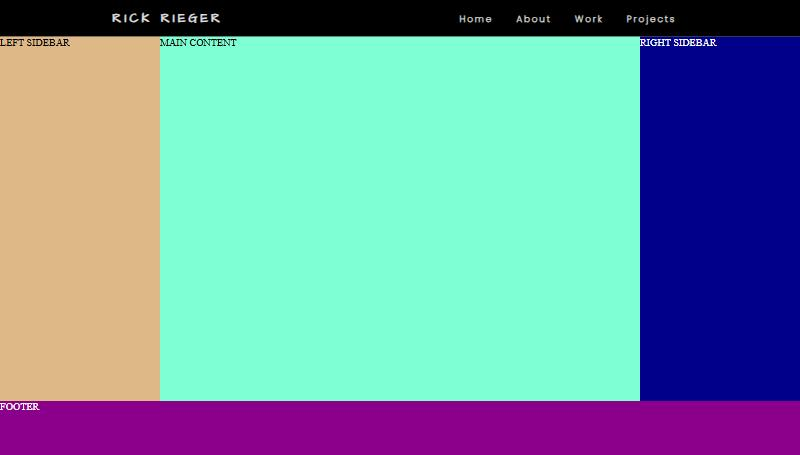
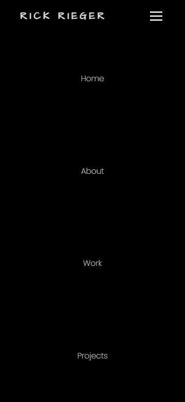

# Responsive Animated Nav Menu (Flexbox + JavaScript)

### 🔗 Live site: **[rickrieger.github.io/FlexBoxAnimateMenu-](https://rickrieger.github.io/FlexBoxAnimateMenu-/)**

| Desktop | Phone, menu open |
|---|---|
|  |  |

A practice project I built on **February 27, 2021**, during the Code Immersives bootcamp in New York City: a **responsive navigation bar**. On a wide screen the links sit in the bar. On a phone they're replaced by a ☰ "hamburger" button that **slides the menu in from the side** and **fades each link in one after another**. Below the nav is a placeholder page layout (colored boxes labeled LEFT SIDEBAR, MAIN CONTENT, RIGHT SIDEBAR and FOOTER) to practice Flexbox columns. This is my own repo, not a fork of an assignment.

**Skills practiced:** Flexbox, media queries, CSS transitions and `@keyframes` animations, and JavaScript DOM events (`querySelector`, `addEventListener`, `classList.toggle`).

**Built with:** HTML, CSS and vanilla JavaScript, with Google Fonts (Poppins, Architects Daughter). No frameworks, no build step.

---

## Contents

- [How it works](#how-it-works)
- [Files](#files)
- [Run it locally](#run-it-locally)
- [Deployment](#deployment)
- [Cleanup log (November 2026)](#cleanup-log-november-2026)

---

## How it works

**1. Flexbox nav bar** (`navBar.css`). The `<nav>` uses `display: flex` with `justify-content: space-around`, which spreads the logo, the link list and the hamburger across the bar. The link list is its own flex row.

**2. Media queries switch layouts.**
- At **1024px and below**, the links get more room (`width: 60%`).
- At **768px and below**, the link list becomes a full-height column positioned off-screen to the right (`transform: translateX(100%)`), and the ☰ button appears.

**3. The slide-in** (`app.js` + CSS). Clicking ☰ toggles a `nav-active` class:

```js
burger.addEventListener('click', () => {
  const isOpen = nav.classList.toggle('nav-active');   // adds or removes the class
  burger.setAttribute('aria-expanded', isOpen);
  ...
});
```

```css
.nav-links { transform: translateX(100%); transition: transform 0.5s ease-in; }  /* hidden off to the right */
.nav-active { transform: translateX(0%); }                                        /* slides into view */
```

Because of the `transition`, the change from 100% to 0% animates over half a second instead of jumping.

**4. Staggered link fade.** Each link starts invisible (`opacity: 0`). On open, JavaScript gives each one the `navLinkFade` animation with a slightly longer delay than the one before (`index / 7 + 0.6` seconds), so they appear one after another:

```js
navLinks.forEach((link, index) => {
  link.style.animation = `navLinkFade 0.5s ease forwards ${index / 7 + 0.6}s`;
});
```

```css
@keyframes navLinkFade {
  from { opacity: 0; transform: translate(50px); }
  to   { opacity: 1; transform: translate(0px); }
}
```

**5. Placeholder layout** (`style.css`). The sidebars and main area sit side by side in a flex row (20% / 60% / 20%) and stack full width on phones.

## Files

```
index.html               page structure: nav, three placeholder columns, footer
navBar.css               nav bar, hamburger, slide-in menu, link animation
style.css                placeholder page layout
app.js                   hamburger click → toggle menu + animate links
docs/                    screenshots for this README
```

## Run it locally

```bash
git clone https://github.com/RickRieger/FlexBoxAnimateMenu-.git
cd FlexBoxAnimateMenu-
# open index.html in a browser, then make the window narrower than 768px to see the hamburger
```

## Deployment

Hosted on **GitHub Pages** from the root of the `master` branch. Every push to `master` redeploys the site within a minute or two.

---

## Cleanup log (November 2026)

All changes below were made on **2026-11-24** on the branch `cleanup`, checked in a browser at desktop (1280px) and phone (375px) widths, and merged into `master`. Each is its own commit.

### 1. Put the nav link text inside the links

**Why:** each item was written with an empty link followed by plain text. The links were **0 pixels wide**, so the words couldn't be clicked, and none of the link styles in `navBar.css` applied (bold, letter spacing, red on hover in the phone menu).

```html
<!-- Before -->
<li><a href="#"></a>Home</li>

<!-- After -->
<li><a href="#">Home</a></li>
```

### 2. Made the hamburger a real `<button>`

**Why:** the ☰ toggle was a `<div>`, so keyboard users couldn't reach it with Tab or open it with Enter or Space, and screen readers didn't announce it as a button. It's now a `<button>` with a label, and the default button styling is reset in CSS so it looks the same. `app.js` updates `aria-expanded` and the label each time it's clicked, so assistive technology knows whether the menu is open.

```html
<!-- Before -->
<div class="burger">
    <div class="line1"></div> ...
</div>

<!-- After -->
<button class="burger" type="button" aria-label="Open menu" aria-expanded="false">
    <div class="line1"></div> ...
</button>
```

```js
// Added in app.js
const isOpen = nav.classList.toggle('nav-active');
burger.setAttribute('aria-expanded', isOpen);
burger.setAttribute('aria-label', isOpen ? 'Close menu' : 'Open menu');
```

### 3. Loaded only the fonts that are used

**Why:** `index.html` repeated the same `preconnect` line four times and loaded two fonts, Bilbo and Over the Rainbow, that nothing uses. Every extra font is an extra download. Now one request loads just Poppins (links) and Architects Daughter (logo). The page title also changed from "Rick Rieger Home" to "Responsive Nav Menu | Rick Rieger", which describes what the page is.

```html
<!-- Before -->
<link rel="preconnect" href="https://fonts.gstatic.com">
<link href="...family=Poppins:wght@200..." rel="stylesheet">
<link rel="preconnect" href="https://fonts.gstatic.com">
<link rel="preconnect" href="https://fonts.gstatic.com">
<link rel="preconnect" href="https://fonts.gstatic.com">
<link href="...family=Architects+Daughter&family=Bilbo&family=Over+the+Rainbow..." rel="stylesheet">

<!-- After -->
<link rel="preconnect" href="https://fonts.gstatic.com" crossorigin>
<link href="...family=Architects+Daughter&family=Poppins:wght@200..." rel="stylesheet">
```

### 4. Fixed the placeholder layout's width and phone view

**Why:**
- The columns were `20vw + 60vw + 20vw`. A `vw` unit includes the vertical scrollbar, so the row could be slightly wider than the page. Percentages fit the page exactly.
- On a phone the three columns shrank to about 75px each. They now stack full width at the same 768px breakpoint the nav uses.
- The labels on the dark blue and magenta boxes were black text on a dark background. They're white now.

```css
/* Before */
main          { width: 60vw; height: 80vh; }
.left-sidebar { width: 20vw; height: 80vh; }

/* After */
main          { width: 60%; height: 80vh; }
.left-sidebar { width: 20%; height: 80vh; }

@media screen and (max-width:768px) {
  .container { flex-direction: column; }
  main, .left-sidebar, .right-sidebar { width: 100%; height: 30vh; }
}
```

### 5. Added this README

The repo had none.
